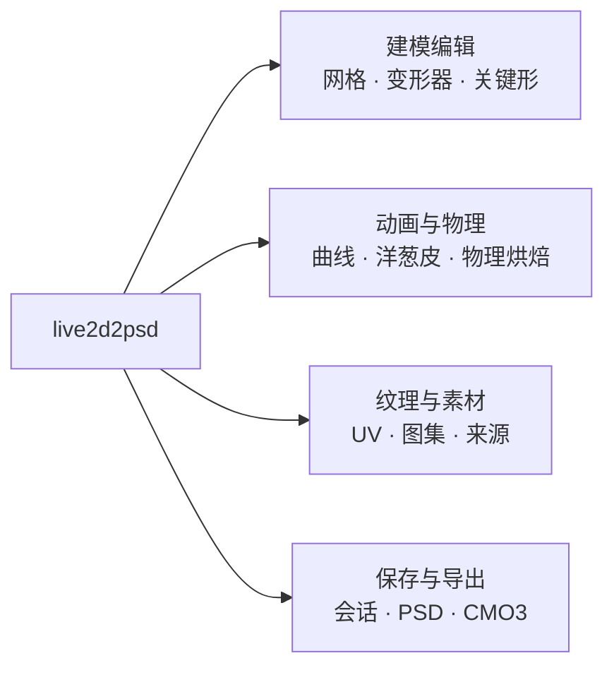
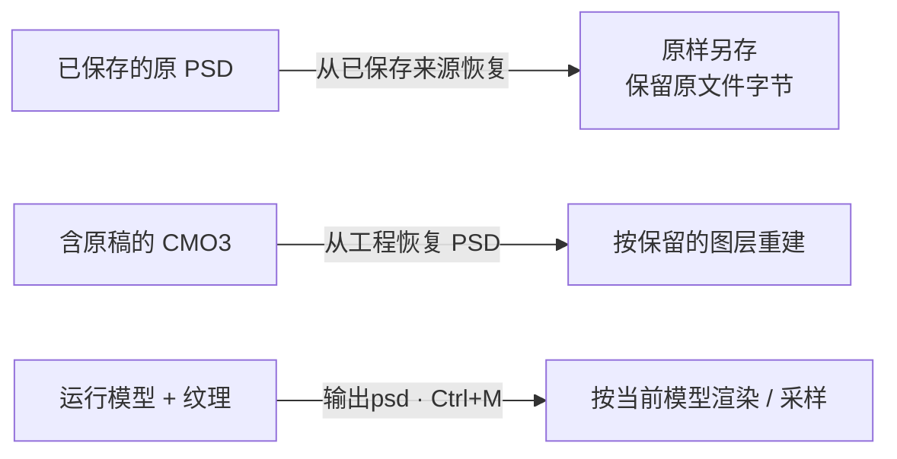
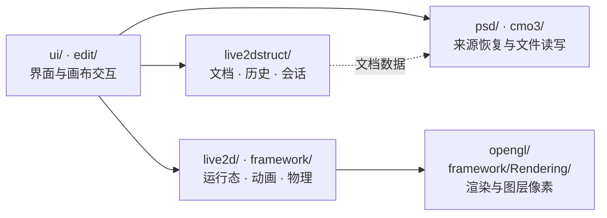

# live2d2psd

**Live2D 模型编辑 · 原稿恢复 · PSD 导出**

从已有模型继续编辑，或从保留的 PSD／CMO3 中恢复素材。

[快速开始](#快速开始) · [功能图](#功能总览) · [项目结构](#项目结构) · [中文指南](documentation/guide.zh-CN.md) · [English](documentation/guide.en.md)

## 功能总览

支持 ArtMesh 克隆、参数管理，以及已支持范围内的 BlendShape 与既有 Glue 权重编辑。[完整功能与边界 →](documentation/guide.zh-CN.md#建模与关键形)

## PSD 应该怎么导出？

**想保留完整原稿，优先走“来源恢复”；想输出当前编辑效果，走“输出psd”。**

三条路径是独立入口。CMO3 与运行模型只能恢复实际保留的信息，不能补造丢失的原稿。[导出说明 →](documentation/guide.zh-CN.md#选择合适的-psd-工作流)

## 快速开始

1. **打开** `.model3.json` 或 `.moc3`，加载配套资源。
2. **编辑** 模型、参数、纹理，或切到动画工作区。
3. **保存工作会话**保留编辑状态，再按需导出 PSD、CMO3 或运行时模型包。

> PSD／CMO3 不是工作会话的替代品。普通 PSD 导出也不会自动切换到保存的原稿。

## 项目结构

主要模块与数据流，非严格依赖图；原稿恢复无需先加载运行模型。

## 构建与测试

| 用途 | 构建入口 | 环境 |
|---|---|---|
| 桌面应用 | qmake；Windows 可用 `build.ps1` | Qt 6、C++17、匹配的 Cubism Core |
| 组件与真实 Core 测试 | CMake 3.21+、CTest | Qt Test；部分测试需要原生 OpenGL |

[Windows / macOS 构建](documentation/guide.zh-CN.md#构建) · [Core 5 / 6 配置](documentation/guide.zh-CN.md#选择匹配的-cubism-core) · [测试说明](documentation/guide.zh-CN.md#组件测试)

> `build.ps1 -Clean` 会删除整个 `build/`。切换 Core／Qt 时需清理旧对象；不要全局用 `QT_QPA_PLATFORM=offscreen` 跑全部 GL 测试。

## 当前边界

- 不是 Cubism Editor 的完整替代品；仅凭 MOC 无法保证找回原始图层、名称或未变形切片。
- 从未关联素材独立创建 ArtMesh／Part 的完整工作流仍在开发；**现有网格克隆已可用**。
- Glue 限既有权重编辑；部分逆变形、Draw Order Group 和 Core 6 混合／离屏导出语义仍有限制。
- 组件测试不等于全部 Photoshop／Cubism Editor GUI、Windows 或旧版 macOS 已验收。

[详细限制](documentation/guide.zh-CN.md#当前限制)

---

[CC BY-NC-SA 4.0](https://creativecommons.org/licenses/by-nc-sa/4.0/) · 仅用于个人研究和学习。Live2D、Qt 等依赖遵循各自许可，见[完整说明](documentation/guide.zh-CN.md#许可证)。
